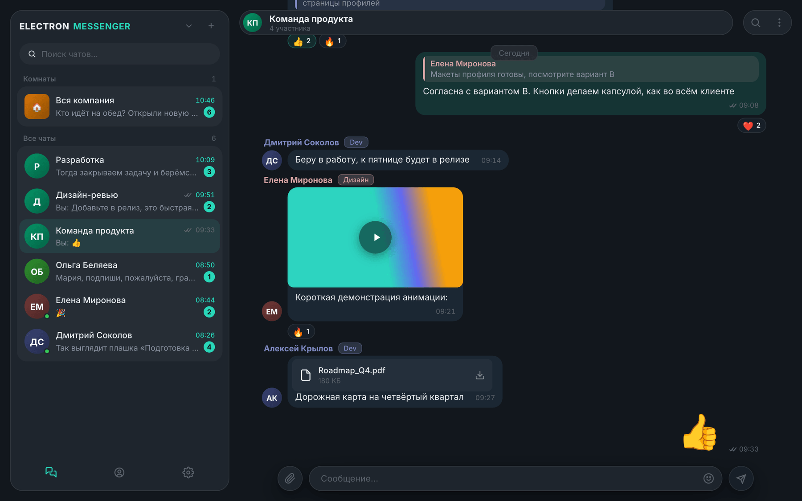
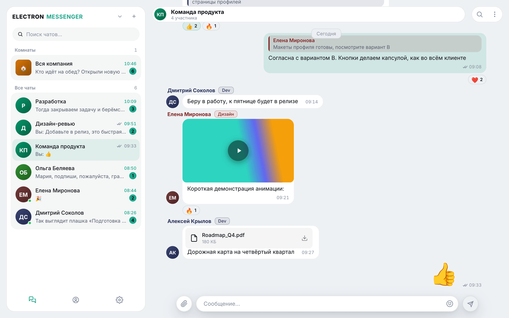
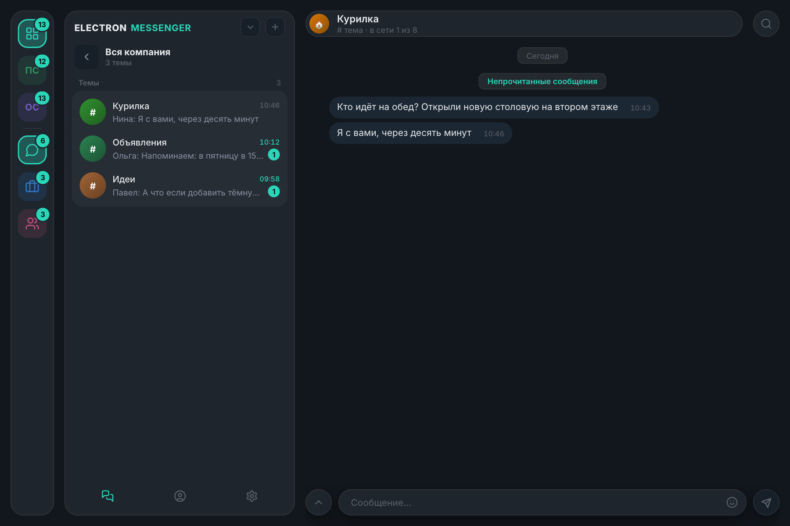
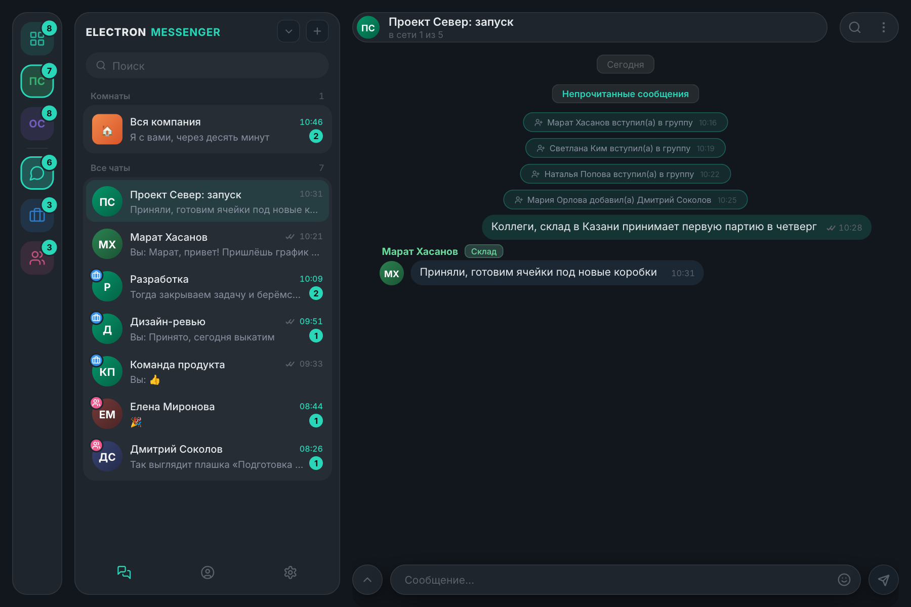
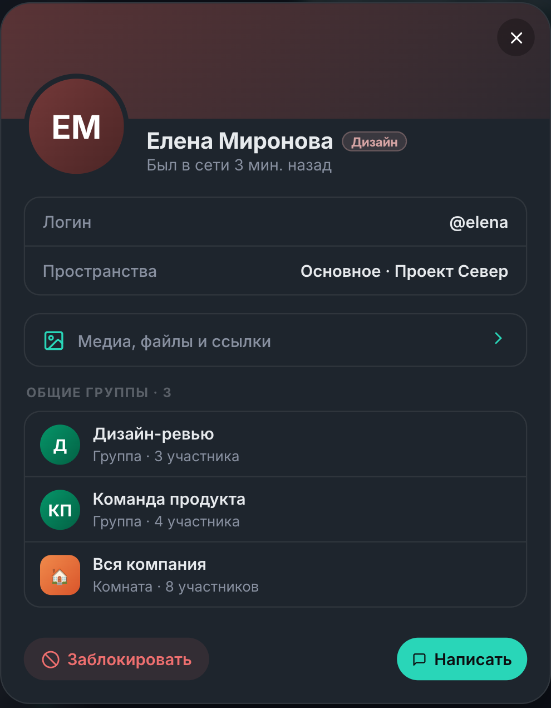
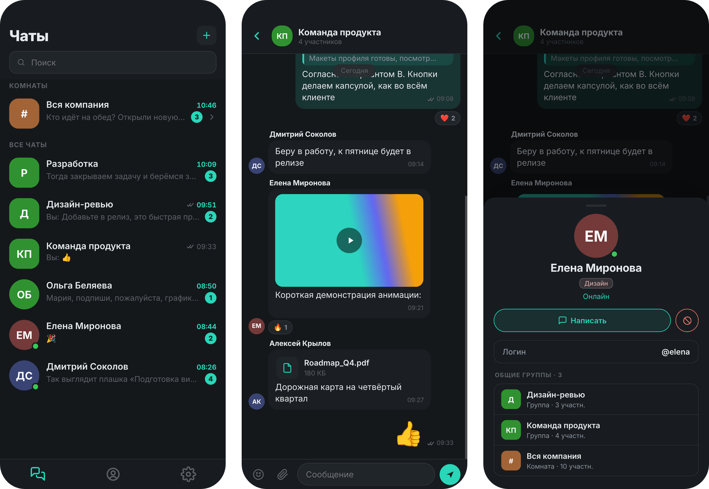
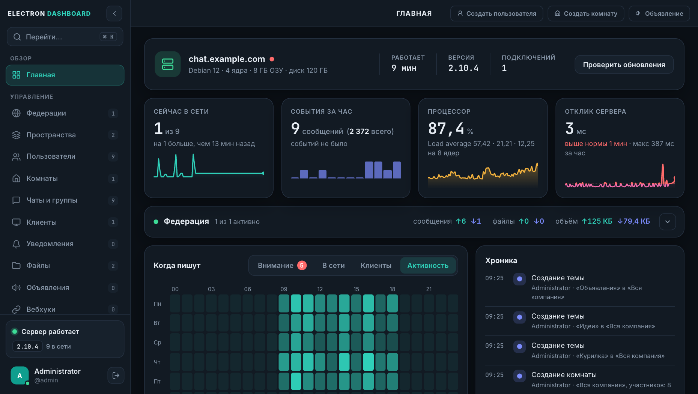
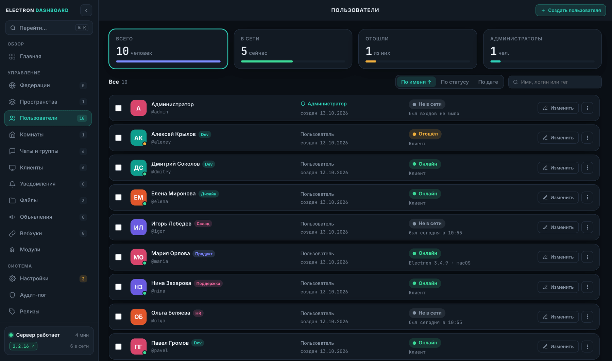
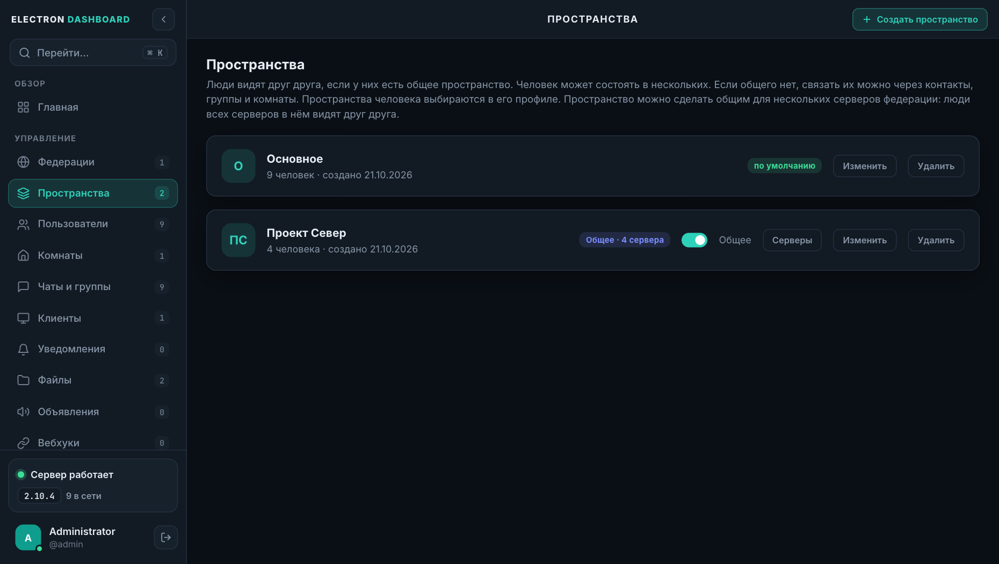
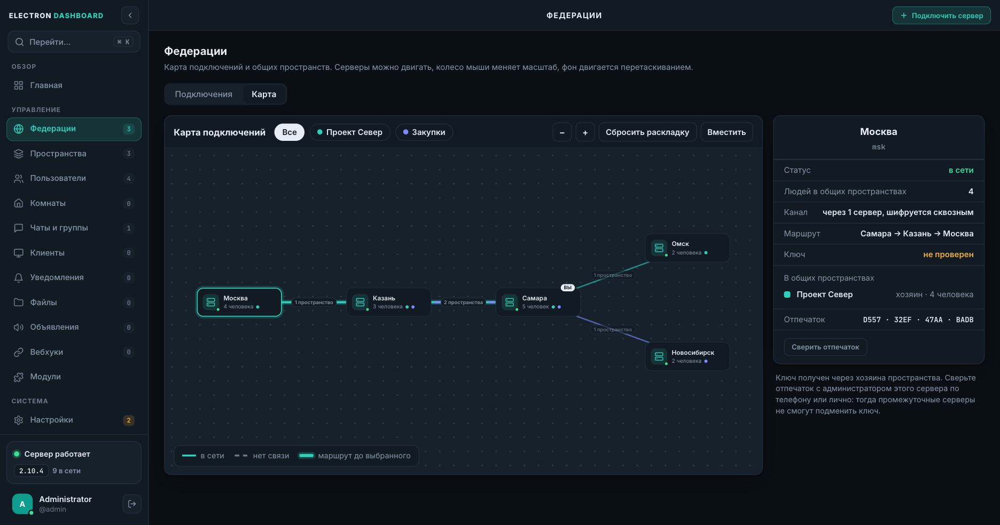

# Electron Messenger

Корпоративный мессенджер, который ставится на ваш собственный сервер. Один сервер обслуживает три клиента: десктопное приложение (macOS, Windows, Linux), веб-клиент в браузере и мобильный клиент, который ставится на экран телефона как приложение (PWA). Всё хранится у вас: база SQLite и файлы лежат рядом с сервером.

Несколько серверов можно соединить в федерацию: люди с разных серверов пишут друг другу, сидят в общих группах и комнатах и даже делят общие пространства, как будто они на одном сервере.



---

## Содержание

1. [Возможности](#возможности)
2. [Скриншоты](#скриншоты)
3. [Установка сервера](#установка-сервера)
4. [Первый вход и админка](#первый-вход-и-админка)
5. [Установка клиентов](#установка-клиентов)
6. [Федерация серверов и общие пространства](#федерация-серверов-и-общие-пространства)
7. [Управление и обновление сервера](#управление-и-обновление-сервера)
8. [Настройка](#настройка)

---

## Возможности

**Общение**
- Личные чаты, группы и комнаты с темами (как каналы с отдельными ветками разговоров).
- Ответы, пересылка, правка и удаление, закрепление, упоминания, реакции любыми эмодзи.
- Форматирование (жирный, курсив, код), блоки кода и скрытый текст «Секрет», который показывается точками, пока его не откроют.
- Превью ссылок: заголовок и картинку страницы забирает сервер, а не устройство отправителя.
- Поиск по сообщениям, статусы «доставлено» и «прочитано», «печатает…», присутствие («в сети», «отошёл»). Если человек сейчас в сети с телефона, на его аватарке вместо точки значок телефона.
- Фото, видео и файлы, до десяти вложений в одном сообщении. Лимиты размера и разрешённые форматы задаёт администратор. В переписке фото показываются лёгкими превью, оригинал открывается в просмотре на весь экран; у чата, группы и человека есть раздел «Медиа, файлы и ссылки».
- GIF из библиотеки Klipy: поиск и отправка прямо из панели смайлов (модуль включается в админке, нужен свой API-ключ Klipy). Файлы у вас не хранятся, в сообщении только ссылка.
- Видео с iPhone (HEVC) сжимается в H.264 прямо на устройстве отправителя, за секунды и без нагрузки на сервер. Если устройство не может, видео перекодирует сервер: по очереди и с низким приоритетом.
- Работа при плохой связи: сообщение без сети остаётся в переписке с пометкой «Не отправлено» и уходит само, когда связь вернулась (повторная отправка не создаёт дубль); приложение открывается без сети с последним списком чатов и сохранёнными сообщениями.
- «Без звука» на час, 8 часов, сутки или навсегда; тихие часы и скрытие текста сообщения в уведомлениях (настройки общие для всех устройств человека).

**Приватность и безопасность**
- Секретные чаты со сквозным шифрованием: сервер хранит только зашифрованные данные.
- Вход в админку защищается двухфакторным кодом (TOTP).
- Аудит-лог действий администраторов, блокировка и выход пользователей с любого устройства.
- Блокировки: заблокированный не может писать в личные сообщения.
- Всё общение между серверами федерации шифруется собственным туннелем независимо от HTTPS.

**Организация**
- Рабочие пространства: люди видят друг друга, если у них есть общее пространство. Человек может состоять в нескольких, в каждом он виден и видит остальных. Людей из других пространств добавляют в контакты по точному логину.
- Папки чатов: личные у каждого, одинаковы на всех устройствах человека.
- Теги у людей («Dev», «HR», «Склад»), профили с общими группами и пространствами.
- Системные объявления: окно с важным сообщением всем, выбранным пространствам, людям или чатам, кто сейчас в сети.
- Вебхуки: сообщения от внешних систем (мониторинг, CRM, CI) приходят в чаты как от бота.

**Федерация серверов**
- Серверы соединяются по одноразовому ключу активации с проверкой отпечатка. Адрес человека на другом сервере: `@сервер:логин`.
- Личные чаты, группы и комнаты с людьми других серверов: сообщения, вложения, реакции, правки, статусы, «печатает…», счётчик «в сети N из M». Работает, даже если один из серверов за NAT.
- **Общие пространства:** пространство можно сделать общим для нескольких серверов. Люди всех этих серверов видят друг друга в списках, поиске и статусах и могут вступать в группы друг друга без подтверждения.
- Серверы можно соединять звездой или цепочкой: личные сообщения и файлы идут через промежуточные серверы зашифрованными, они видят только «кто с кем».
- В админке есть карта серверов и общих пространств.

**Клиенты**
- Три темы (светлая, тёмная, тёмно-синяя; в мобильном светлая и тёмно-синяя), акценты, push-уведомления, значок и меню в трее.
- Десктопный клиент обновляется сам, веб и мобильный — вместе с сервером.
- Мобильный клиент: жесты как в нативных приложениях (свайп назад, свайп по строке чата, свайп по сообщению для ответа), плавные переходы, шторка пространств.
- Настройка «Отображать пространства»: в баре клиента (под учётными записями и выше папок) и в шторке мобильного появляются «Общий вид» и все ваши пространства. Выбор оставляет в списках чатов и контактов только людей из пространства и чаты с ними.

**Админка** (`/admin`, подстраивается под телефон)
- Главная: нагрузка сервера, отклик, кто в сети, активность по часам, хроника событий, сводка по федерации.
- Пользователи, пространства (в том числе общие), комнаты, чаты и группы, подключённые клиенты (принудительное обновление и выход), уведомления, файлы, объявления, вебхуки, модули, аудит-лог, федерации (соединения и карта).
- Резервные копии и восстановление, настройки, история релизов, обновление сервера в один клик.

---

## Скриншоты

### Десктопный клиент

Пространства и папки в баре слева: «Общий вид» и пространства выше, папки ниже.

| Светлая тема | Комнаты с темами |
|:---:|:---:|
|  |  |

### Общее пространство и люди с других серверов

| Группа с людьми других серверов | Профиль человека |
|:---:|:---:|
|  |  |

### Мобильный клиент

Список чатов с кнопкой пространства и папками, шторка пространств (список сдвигается до середины окна), переписка.



### Админка









> На скриншотах демонстрационные данные: вымышленные люди, чаты и серверы.

---

## Установка сервера

Нужен сервер на Linux (Ubuntu / Debian, CentOS / RHEL / Rocky Linux или Arch Linux) с доступом root.

### 1. Клонировать репозиторий

```bash
git clone https://github.com/bolgov0zero/Electron-Messenger.git /opt/electron-messenger
cd /opt/electron-messenger/server
```

### 2. Запустить установку

```bash
sudo bash install.sh
```

Скрипт сам:
- установит Node.js 20, если его нет;
- установит зависимости (`npm install`);
- установит ffmpeg (нужен для превью видео и перекодирования);
- создаст папку базы `electron_db` (рядом с папкой `server`) и в ней базу `main_base.db`;
- создаст и запустит службу systemd `electron`;
- зарегистрирует команду `electron` для управления сервером.

После установки сервер доступен по адресу:

```
http://<IP-сервера>:3000
```

| Адрес | Что там |
|-------|---------|
| `/chat` | Веб-клиент |
| `/m` | Мобильный клиент |
| `/admin` | Админка |

### 3. Открыть порт (если включён firewall)

```bash
# Ubuntu / Debian
sudo ufw allow 3000/tcp

# CentOS / RHEL
sudo firewall-cmd --permanent --add-port=3000/tcp
sudo firewall-cmd --reload
```

### HTTPS и reverse-proxy (рекомендуется)

Для работы в интернете поставьте перед сервером nginx (или любой другой прокси) с сертификатом. Нужны два пункта: передача WebSocket и разрешение на крупные файлы. Через тот же WebSocket работают и клиенты, и соединения федерации (`/fed`), поэтому отдельная настройка для федерации не нужна.

```nginx
server {
    listen 443 ssl http2;
    server_name chat.example.com;
    # ssl_certificate / ssl_certificate_key ...

    client_max_body_size 500m;

    location / {
        proxy_pass http://127.0.0.1:3000;
        proxy_http_version 1.1;
        proxy_set_header Host $host;
        proxy_set_header X-Real-IP $remote_addr;
        proxy_set_header X-Forwarded-For $proxy_add_x_forwarded_for;
        proxy_set_header X-Forwarded-Proto $scheme;
        proxy_set_header Upgrade $http_upgrade;
        proxy_set_header Connection "upgrade";
        proxy_read_timeout 900s;
        proxy_send_timeout 900s;
    }
}
```

Без HTTPS работают клиенты, но не будут работать push-уведомления в браузере и установка мобильного клиента на экран телефона.

---

## Первый вход и админка

Откройте `http://<IP-сервера>:3000/admin`.

**Логин и пароль по умолчанию:** `admin` / `admin`. При первом входе сервер потребует сменить пароль.

Что сделать сначала:
1. Сменить пароль администратора.
2. Создать пользователей (раздел «Пользователи» → «Создать пользователя»).
3. Создать комнату для всей команды («Комнаты» → «Создать комнату»).
4. Задать лимиты файлов и остальные параметры («Настройки»).
5. Включить двухфакторную защиту входа в админку (по желанию).
6. При необходимости разделить людей по пространствам («Пространства») или подключить другие серверы («Федерации»).

---

## Установка клиентов

### Десктопный клиент

Готовые сборки лежат на странице [Releases](https://github.com/bolgov0zero/Electron-Messenger/releases): скачайте файл из последнего релиза с тегом `c…`.

| Система | Файл | Как поставить |
|---------|------|---------------|
| macOS (Apple Silicon) | `.dmg` | Открыть, перетащить **Electron** в «Программы» |
| Windows 10/11 (x64) | `.exe` | Запустить установщик |
| Linux (x64, Debian/Ubuntu) | `.deb` | `sudo apt install ./<скачанный-файл>.deb` |

На macOS при первом запуске выберите правой кнопкой мыши **Открыть** → **Открыть**. Если система заблокировала приложение:

```bash
xattr -d com.apple.quarantine /Applications/Electron.app
```

**Первый вход:** введите адрес сервера (например, `chat.example.com` или `192.168.1.10:3000`), логин и пароль. Приложение запоминает сервер и сессию, можно подключить несколько аккаунтов.

### Веб-клиент

Откройте `http://<адрес-сервера>/chat` в браузере и войдите.

### Мобильный клиент

1. Откройте `http://<адрес-сервера>/m` на телефоне (для установки нужен HTTPS).
2. iPhone: Safari → «Поделиться» → **На экран «Домой»**. Android: меню браузера → **Установить приложение**.
3. Войдите. Приложение открывается на весь экран и получает уведомления.

---

## Федерация серверов и общие пространства

Федерация соединяет независимые серверы: у каждого своя база, свои пользователи и свой администратор. Управлять чужим сервером через соединение нельзя: только обмениваться сообщениями между людьми.

### Подключение двух серверов

Все действия в админке, раздел **«Федерации»**.

1. На каждом сервере один раз задайте **уникальный идентификатор** (латиница, цифры, точка, дефис; потом он не меняется, входит в адрес людей) и **имя системы** (его видят только администраторы партнёров).
2. На одном из серверов создайте **ключ активации** (нужен адрес для соединений: по нему к вам подключится партнёр). Ключ одноразовый и действует 24 часа.
3. На втором сервере выберите «У меня есть ключ» и вставьте его. Сверьте **отпечаток ключа** с администратором партнёра по телефону или лично и подтвердите.

Соединение держит один постоянный зашифрованный WebSocket на `/fed`. Подключается всегда та сторона, которая вводила ключ, поэтому серверу за NAT открытый адрес не нужен. Всё общение шифруется собственным туннелем независимо от HTTPS. Соединение можно приостановить или удалить, пока оно приостановлено, сообщения ждут в очереди (до 14 дней).

### Что работает между серверами

- Контакты по адресу `@сервер:логин` и личные чаты, ответы, пересылка, правки, удаления, реакции, статусы «доставлено» и «прочитано».
- Группы и комнаты с людьми других серверов: группу создаёт и ведёт сервер-хозяин, у остальных серверов её зеркало. Человека приглашают, и он сам соглашается (в комнаты людей других серверов приглашает администратор по адресу `@сервер:логин`).
- Вложения и аватарки копируются на ваш сервер, размеры и форматы проверяются по вашим настройкам.
- Лимиты и защита: не больше N новых переписок и приглашений в группы в час с одного сервера, переключатель приёма приглашений в группы («Федерации»).
- У людей и групп с другого сервера в клиентах значок земного шара. Названия серверов видят только администраторы.

### Общие пространства

Пространство можно сделать **общим** для нескольких серверов. Люди всех этих серверов, добавленные в него, видят друг друга в списках, поиске и статусах, пишут друг другу и вступают в группы друг друга без подтверждения, как будто они на одном сервере.

1. На сервере-хозяине откройте **«Пространства»**, включите переключатель **«Общее»** у нужного пространства (у «Основного» его нет) и нажмите **«Серверы»**.
2. Пригласите подключённый сервер (нужно прямое соединение с ним, сервер должен быть обновлён).
3. Администратор второго сервера в «Пространствах» принимает приглашение: пространство появляется у него.
4. **Каждый сервер сам добавляет в пространство своих людей** в их профилях («Пространства» человека) и видит чужих. Убрать можно только своих людей; название пространства задаёт хозяин.
5. Хозяин может убрать сервер из пространства целиком или выключить «Общее»; сервер может выйти сам. У вышедших пространство остаётся обычным, переписки сохраняются.

**Звезда и каскад.** Хозяин приглашает только серверы, с которыми он соединён напрямую. Участник расширяет пространство на своего соседа так: просит хозяина, тот одобряет, участник приглашает. Получается дерево серверов: звезда, цепочка или то и другое. Между серверами без прямого соединения работают **сквозные шифрованные каналы**: личные сообщения, файлы и статусы идут через промежуточные серверы, которые видят только «кто с кем», размер и время. Ключ дальнего сервера приходит через хозяина пространства; администратор может **сверить отпечаток** вручную (помечается «проверен»).

В клиентах включите **«Отображать пространства»** (десктопный и веб: «Настройки → Папки и пространства»; мобильный: «Настройки»), чтобы выбирать пространство в баре или свайпом вправо по списку чатов в мобильном.

### Карта федерации

В «Федерациях» вкладка **«Карта»**: серверы с именами, соединения, цвета общих пространств, состояние линий и маршрут до выбранного сервера. Серверы двигаются мышью (раскладка запоминается в браузере), колесо мыши меняет масштаб, фон двигается перетаскиванием. Карта у всех серверов общего пространства одна: её собирает хозяин. Свои остальные подключения другим серверам не показываются.

### Требования

Серверы должны быть обновлены до версии с нужной возможностью: группы и комнаты с людьми других серверов (сервер 2.7+), общие пространства (2.10+), теги людей из них (2.10.3+). Более старые серверы приглашение в общее пространство получить не могут.

---

## Управление и обновление сервера

Команда `electron` в консоли открывает панель управления:

```bash
electron
```

```
●  Работает

    Версия        2.10.4
    Порт          3000

  [1] Остановить    [2] Перезапустить
  [3] Обновить      [4] Проверить обновления
  [5] Логи          [6] Обновить + модули
  [0] Выйти
```

**[3] Обновить** скачивает последнюю версию с GitHub и перезапускает сервер без потери данных. **[6]** делает то же и дополнительно переустанавливает зависимости (`npm install`). Обновить сервер можно и из админки (раздел «Главная» или «Релизы»).

Стандартные команды systemd:

```bash
systemctl status electron
systemctl restart electron
journalctl -u electron -f
```

Резервные копии (база и файлы) создаются и восстанавливаются в админке: «Настройки» → «Резервные копии».

---

## Настройка

Переменные окружения задаются в `/etc/systemd/system/electron.service`:

| Переменная | По умолчанию | Описание |
|-----------|-------------|----------|
| `PORT` | `3000` | Порт сервера |
| `JWT_SECRET` | генерируется при установке | Секрет для токенов входа |
| `DB_PATH` | `../electron_db/main_base.db` (задаёт установка) | Путь к базе данных SQLite. Вложения, аватарки и резервные копии лежат рядом с ней, в `files/`, `avatar/` и `backups/` |
| `TRANSCODE_PARALLEL` | `1` | Сколько видео сервер перекодирует одновременно |

После изменения:

```bash
systemctl daemon-reload
systemctl restart electron
```

> **Где лежат данные.** Новые установки создают базу в `electron_db/main_base.db`. Установки, сделанные раньше, продолжают работать с `chat_db/chat.db`: путь записан в службе systemd, и повторный запуск `install.sh` его не меняет. Чтобы перенести данные в другое место, остановите службу, переместите папку вместе с `-wal` и `-shm` файлами базы и поправьте `DB_PATH` в службе.

Остальное (лимиты вложений, срок хранения файлов, время на правку сообщений, федерация, пространства, модули, резервные копии) настраивается в админке.

---

История изменений — в [RELEASE_HISTORY.md](RELEASE_HISTORY.md).
